# Class Deadline Hub

Cổng web deadline của lớp, viết bằng **Next.js 15 (App Router)**, **Auth.js (NextAuth v5)** và **TypeScript**.

- Ai cũng xem được deadline công khai; link chia sẻ có ảnh xem trước (Open Graph) và Google lập chỉ mục được.
- Sinh viên đăng nhập để đánh dấu deadline đã xong.
- Lớp trưởng (admin) thêm và xoá deadline.
- Dữ liệu lưu trong các file JSON phía server (`data/`): 4 môn học, 12 deadline.

| Email               | Mật khẩu   | Vai trò |
| ------------------- | ---------- | ------- |
| `admin@ptit.edu.vn` | `admin123` | admin   |
| `sv@ptit.edu.vn`    | `sv123456` | user    |

---

## 1. Cách chạy

Yêu cầu: Node.js ≥ 18.18 (đã thử với Node 24), npm.

```bash
npm install
cp .env.example .env.local      # rồi điền AUTH_SECRET (xem bên dưới)
npx auth secret                 # hoặc tự sinh: openssl rand -base64 32

# Chế độ phát triển
npm run dev                     # http://localhost:3000

# Bản production (dùng để đo Lighthouse)
npm run build
npm start                       # http://localhost:3000
```

Biến môi trường (`.env.local`):

| Biến                                   | Ý nghĩa                                                             |
| -------------------------------------- | ------------------------------------------------------------------- |
| `AUTH_SECRET`                          | Khoá ký/mã hoá JWT của Auth.js (**bắt buộc**)                       |
| `AUTH_TRUST_HOST=true`                 | Cho phép `next start` ở localhost                                   |
| `NEXT_PUBLIC_SITE_URL`                 | URL công khai, dùng cho canonical, sitemap, JSON-LD, ảnh OG          |
| `AUTH_GITHUB_ID`, `AUTH_GITHUB_SECRET` | (Tuỳ chọn) bật nút "Đăng nhập với GitHub"                           |

> Đặt lại dữ liệu mẫu: các file trong `data/` là "cơ sở dữ liệu". Muốn quay về ban đầu chỉ cần khôi phục `data/deadlines.json` và `data/progress.json`.
> Thêm tài khoản: `npm run hash -- <mật-khẩu>` để lấy bcrypt hash rồi thêm vào `data/users.json`.

### Cấu trúc thư mục

```
app/
├─ layout.tsx                    # root: next/font (Be Vietnam Pro, subset vietnamese), metadataBase
├─ (public)/                     # NHÓM CÔNG KHAI — layout riêng, không đọc cookie ở server
│  ├─ layout.tsx
│  ├─ page.tsx                   # /                 SSG
│  ├─ login/page.tsx             # /login            noindex
│  ├─ subjects/page.tsx          # /subjects         SSG
│  ├─ subjects/[slug]/page.tsx   # /subjects/[slug]  SSG (generateStaticParams)
│  └─ deadlines/
│     ├─ (list)/page.tsx         # /deadlines        ISR revalidate = 60
│     ├─ (list)/loading.tsx      # skeleton
│     ├─ (list)/error.tsx        # lỗi + nút "Thử lại"
│     └─ [id]/
│        ├─ page.tsx             # /deadlines/[id]   ISR on-demand + metadata động + JSON-LD
│        ├─ not-found.tsx        # 404 riêng của deadline
│        └─ opengraph-image.tsx  # ảnh chia sẻ 1200×630 cho từng deadline
├─ (app)/                        # NHÓM ỨNG DỤNG — layout riêng, SSR, đọc phiên đăng nhập
│  ├─ layout.tsx
│  ├─ dashboard/layout.tsx       # layout lồng: sidebar (Tổng quan / Chưa xong / Đã hoàn thành)
│  ├─ dashboard/{page,pending/page,done/page,loading}.tsx
│  └─ admin/page.tsx             # chỉ admin
├─ 403/page.tsx · not-found.tsx · error.tsx
├─ sitemap.ts · robots.ts · icon.svg
└─ api/auth/[...nextauth]/route.ts · api/progress/route.ts
auth.config.ts   # cấu hình Edge-safe (callbacks jwt/session) — dùng chung với middleware
auth.ts          # Credentials (bcrypt + zod) + GitHub (tuỳ chọn)
middleware.ts    # bảo vệ /dashboard, /admin
lib/permissions.ts  # MA TRẬN PHÂN QUYỀN + can(role, action) — nơi duy nhất
lib/actions.ts      # Server Actions: đánh dấu xong, thêm, xoá (tự kiểm tra quyền + zod)
lib/session.ts      # requirePermission() cho trang server
lib/db.ts           # đọc/ghi file JSON (server-only)
types/next-auth.d.ts  # khai báo kiểu Session/JWT có id + role
```

---

## 2. Kết quả `npm run build` và chiến lược render

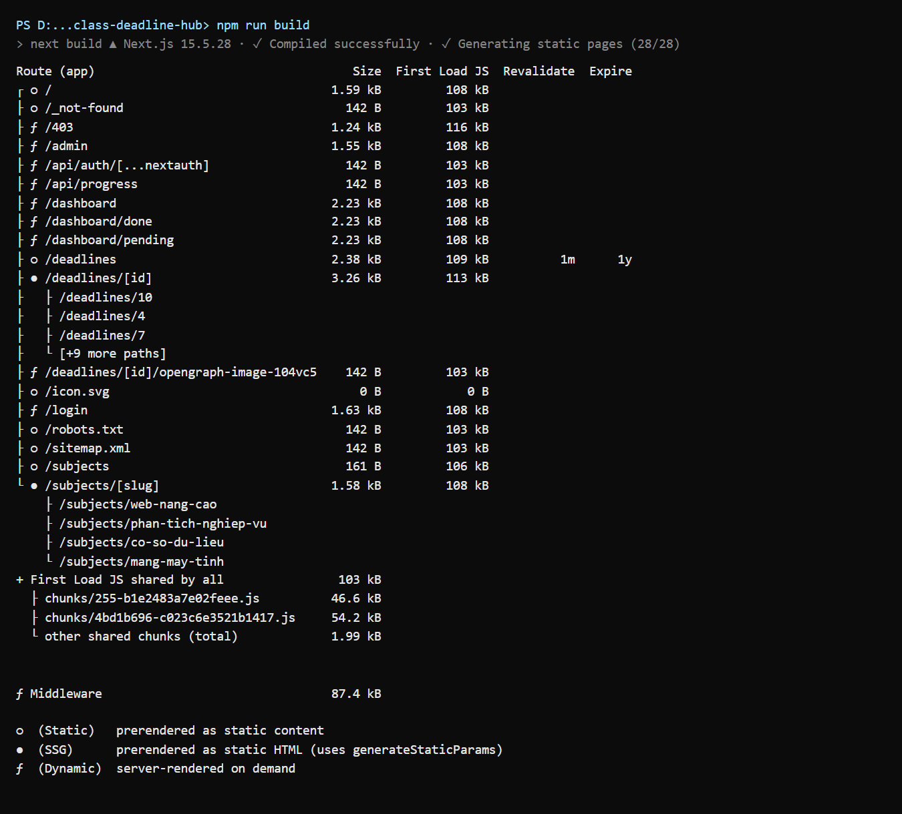

Ký hiệu: `○` tĩnh (SSG) · `●` SSG có `generateStaticParams` · cột **Revalidate 1m** là ISR · `ƒ` render động (SSR).

| Route              | Ai xem      | Chiến lược | Cách cài đặt | Lý do chọn |
| ------------------ | ----------- | ---------- | ------------ | ---------- |
| `/`                | Mọi người   | **SSG** `○` | `dynamic = "force-static"` | Trang giới thiệu, giống hệt nhau với mọi người, ít đổi → sinh HTML một lần lúc build, phục vụ từ CDN nhanh nhất. Số ngày còn lại tính ở client nên HTML tĩnh không bị "cũ". Khi admin thêm/xoá, Server Action gọi `revalidatePath("/")` để mục "Sắp đến hạn" không trỏ tới deadline đã xoá. |
| `/subjects/[slug]` | Mọi người   | **SSG** `●` | `generateStaticParams()` trả 4 slug | Chỉ có 4 môn, biết trước lúc build. Slug lạ → `notFound()` (404). Trang cũng được `revalidatePath` khi deadline của môn đó thay đổi. |
| `/deadlines`       | Mọi người   | **ISR 60 giây** | `export const revalidate = 60` | Danh sách thay đổi nhưng không cần tức thì. Trang vẫn tĩnh (nhanh, chịu tải tốt); tối đa 60 giây sau khi dữ liệu đổi, request kế tiếp sẽ kích hoạt tái tạo nền (stale-while-revalidate). Bộ lọc chạy ở client trên dữ liệu đó. |
| `/deadlines/[id]`  | Mọi người   | **ISR on-demand** `●` | `generateStaticParams` + `revalidate = false` + `dynamicParams = true`; Server Action gọi `revalidatePath("/deadlines/" + id)` | Đây là trang được chia sẻ và Google lập chỉ mục nên cần HTML tĩnh đầy đủ metadata. Không dùng làm mới theo thời gian mà **làm mới ngay khi admin thêm/xoá**: xoá xong thì URL trả 404 ngay; deadline mới được render lần đầu khi có người truy cập rồi được cache. |
| `/dashboard`       | Đã đăng nhập | **SSR** `ƒ` | đọc `auth()` (cookie) + `dynamic = "force-dynamic"` | Nội dung riêng cho từng người (tiến độ của tôi), thay đổi sau mỗi lần tích ô → phải render mỗi request, không được cache chung. |
| `/admin`           | Chỉ admin    | **SSR** `ƒ` | `requirePermission("deadline:create")` + `force-dynamic` | Cần dữ liệu mới nhất và phải kiểm tra quyền trên từng request. |

Các route khác: `/login` động (đọc `searchParams`), `/sitemap.xml` và `/robots.txt` tĩnh, ảnh OG `revalidate = 3600` (trong ảnh có "Còn X ngày").

> Thông báo `A Node.js API is used (CompressionStream)… not supported in the Edge Runtime` khi build đến từ thư viện `jose` mà Auth.js dùng trong middleware. Đây là cảnh báo đã biết, không ảnh hưởng (middleware chỉ giải mã JWT).

### Server Component và `'use client'`

Mặc định mọi trang/layout là Server Component. Chỉ những component cần tương tác mới dùng `'use client'`:

| Client Component | Vì sao |
| ---------------- | ------ |
| `components/countdown.tsx` (`CountdownBadge`, `CountdownStat`, `TimelineDot`) | Hiển thị **"Còn X ngày / Quá hạn Y ngày"** theo giờ thật của người xem, tự cập nhật mỗi 30 giây (HTML tĩnh không chứa con số cũ). |
| `components/deadline-filter.tsx` | **Bộ lọc** theo môn / trạng thái. |
| `nav-links.tsx`, `dashboard-nav.tsx` | Tô sáng menu hiện tại (`usePathname`). |
| `user-menu.tsx`, `login-form.tsx`, `mark-done-button.tsx`, `dashboard-task.tsx`, `admin-forms.tsx` | Đăng nhập/đăng xuất, nút & ô đánh dấu (gọi Server Action), form admin (`useActionState`). |
| `error.tsx`, `error-panel.tsx`, `not-found-view.tsx` | `error.tsx` bắt buộc là client (nút "Thử lại" gọi `reset()`); 404 đọc id từ URL. |

---

## 3. Xác thực và phân quyền

- **Auth.js Credentials**, `session.strategy = "jwt"`. Mật khẩu lưu dạng **bcrypt hash** trong `data/users.json`, dữ liệu đăng nhập được kiểm tra bằng **zod**.
- `id` và `role` được chép vào JWT ở callback `jwt` rồi đưa vào session ở callback `session`. Kiểu được khai báo trong [types/next-auth.d.ts](types/next-auth.d.ts): `role: AuthRole` với `type AuthRole = "user" | "admin"`, **không dùng `string`**.
- Header hiển thị tên, vai trò (Sinh viên / Lớp trưởng) và nút Đăng nhập hoặc Đăng xuất.

### Ma trận phân quyền — một nơi duy nhất: [lib/permissions.ts](lib/permissions.ts)

| Hành động (`Action`) | guest | user | admin |
| -------------------- | :---: | :--: | :---: |
| `deadline:view` — Xem deadline        | ✓ | ✓ | ✓ |
| `deadline:mark` — Đánh dấu đã xong     | ✗ | ✓ | ✓ |
| `deadline:create` — Thêm deadline      | ✗ | ✗ | ✓ |
| `deadline:delete` — Xoá deadline       | ✗ | ✗ | ✓ |

```ts
can(role, "deadline:create") // dùng ở middleware, trang /admin, Server Action, UI
```

### Các lớp bảo vệ

1. **Middleware** ([middleware.ts](middleware.ts)) chặn `/dashboard/*` và `/admin/*`: chưa đăng nhập → `/login?callbackUrl=<đường dẫn cũ>`; đăng nhập nhưng thiếu quyền (user vào `/admin`) → `/403`. Bảng route → hành động cũng nằm trong `lib/permissions.ts`.
2. **Trang server**: `/admin` và `/dashboard` tự gọi `requirePermission()` ([lib/session.ts](lib/session.ts)).
3. **Mọi Server Action** ([lib/actions.ts](lib/actions.ts)) tự gọi `auth()` + `can()` trước khi làm gì, rồi kiểm tra dữ liệu đầu vào bằng **zod** (tên 3–120 ký tự, môn học phải tồn tại, hạn nộp đúng định dạng và **phải sau thời điểm hiện tại**, mô tả ≤ 1000 ký tự, id là số nguyên dương và deadline phải tồn tại).
4. `callbackUrl` ở trang đăng nhập chỉ chấp nhận đường dẫn nội bộ (chống open redirect).

---

## 4. SEO

- **Metadata động** cho `/deadlines/[id]` (`generateMetadata`): title, description, canonical, Open Graph, Twitter card.
- **Ảnh chia sẻ riêng cho từng deadline**: [opengraph-image.tsx](app/(public)/deadlines/[id]/opengraph-image.tsx) sinh PNG 1200×630 bằng `next/og` (màu theo môn, "Còn X ngày", font Be Vietnam Pro đủ dấu tiếng Việt).

  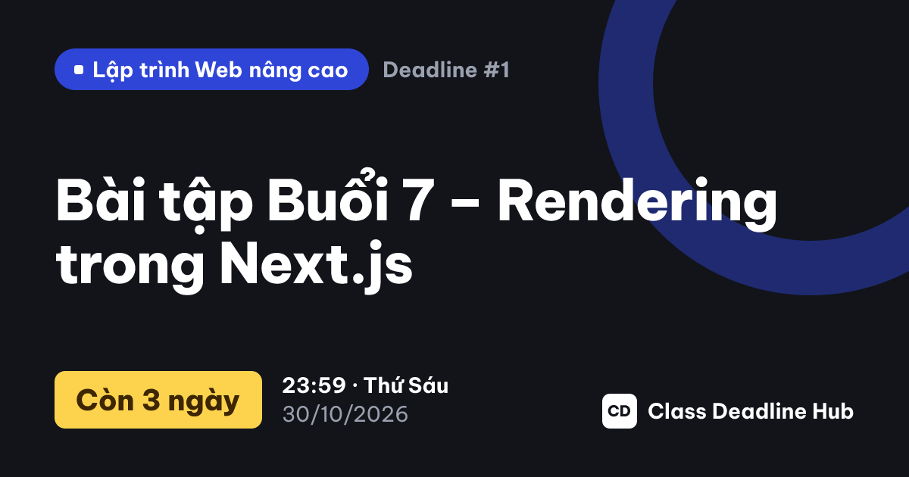

- **Sitemap** [app/sitemap.ts](app/sitemap.ts): trang chủ, `/deadlines`, `/subjects`, 4 môn và **mọi deadline** (được revalidate khi admin thêm/xoá).
- **Robots** [app/robots.ts](app/robots.ts): `Disallow: /dashboard, /admin, /api/, /403`.
- **Không lập chỉ mục** `/login` và `/dashboard`: `<meta name="robots" content="noindex, nofollow">` (layout nhóm `(app)` và trang login). `/login` cố ý *không* chặn trong robots.txt, vì nếu chặn thì Google không đọc được thẻ `noindex`.
- **JSON-LD `BreadcrumbList`** ở trang chi tiết (Trang chủ → Deadline → tên deadline).
- **`next/font`** (`Be_Vietnam_Pro`, `subsets: ["latin", "vietnamese"]`) và **`next/image`** (logo, ảnh đại diện GitHub).

### View-source của `/deadlines/1`

HTML trả về từ server đã có sẵn title, description, canonical, og:image và JSON-LD, nên crawler không cần chạy JavaScript:

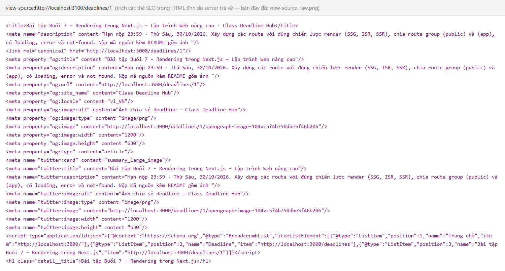

<details><summary>Ảnh view-source đầy đủ (Chrome)</summary>

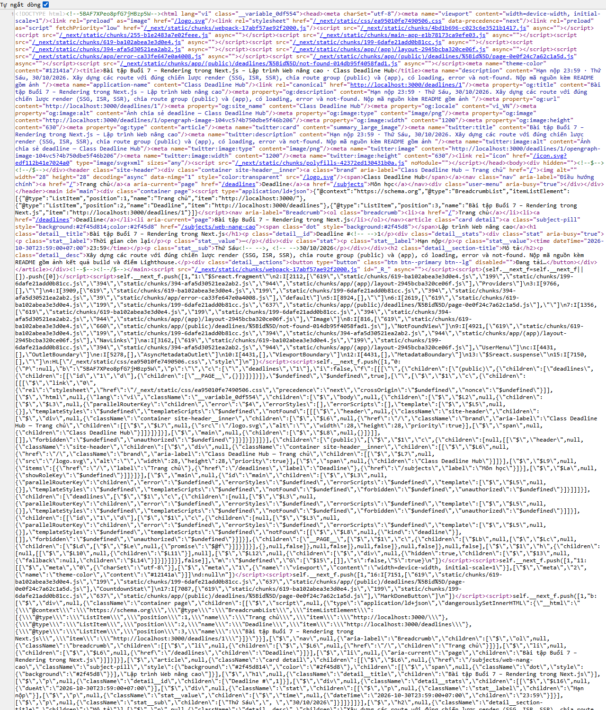

</details>

---

## 5. Điểm Lighthouse (bản production: `npm run build && npm start`, Lighthouse 12, Chrome headless)

| Trang           | Thiết bị | Performance | Accessibility | Best Practices | SEO | FCP | LCP | TBT | CLS |
| --------------- | -------- | :---------: | :-----------: | :------------: | :-: | --- | --- | --- | --- |
| `/`             | Mobile   | **95**  | **100** | **100** | **100** | 1.8 s | 2.8 s | 40 ms | 0 |
| `/`             | Desktop  | **100** | **100** | **100** | **100** | 0.4 s | 0.6 s | 0 ms  | 0 |
| `/deadlines/1`  | Mobile   | **95**  | **100** | **100** | **100** | 1.8 s | 2.8 s | 40 ms | 0.004 |
| `/deadlines/1`  | Desktop  | **100** | **100** | **100** | **100** | 0.4 s | 0.5 s | 0 ms  | 0 |

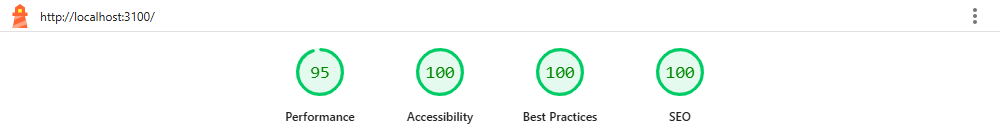
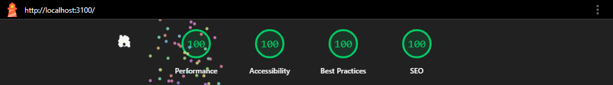
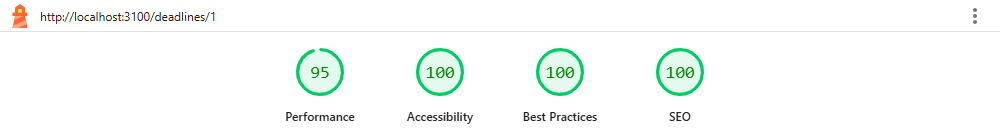
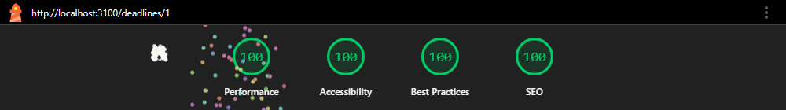

(Mobile dùng giả lập mạng 4G chậm + CPU ×4 mặc định của Lighthouse, nên FCP/LCP cao hơn desktop.)

---

## 6. Trả lời câu hỏi

### (1) Vì sao `/deadlines/[id]` dùng ISR?

- **Cần HTML tĩnh cho SEO và chia sẻ.** Đây là trang được gửi link cho cả lớp và cần Google tìm thấy. Với ISR, HTML (title, description, og:image, JSON-LD) được sinh sẵn và phục vụ ngay từ cache/CDN, nhanh như SSG. Bot của Facebook/Zalo/Google đọc được đầy đủ mà không phải chạy JS.
- **Nội dung giống nhau với mọi người và hiếm khi đổi.** Không có lý do để SSR render lại mỗi request; phần riêng của từng người (đã xong hay chưa, số ngày còn lại theo giờ thật) được tách ra client component.
- **Nhưng nội dung *có* đổi khi admin thêm/xoá**, nên SSG thuần (chỉ build một lần) là không đủ: deadline mới sẽ không có trang, deadline đã xoá vẫn còn trang. ISR giải quyết cả hai:
  - **On-demand revalidation**: Server Action thêm/xoá gọi `revalidatePath("/deadlines/" + id)`, nên trang được làm mới **ngay**, ví dụ xoá xong truy cập lại thì nhận 404 ngay lập tức.
  - `dynamicParams = true`: id mới (chưa có lúc build) được render ở lần truy cập đầu rồi cache lại.
- So với ISR theo thời gian (như `/deadlines` 60 giây), on-demand vừa không bị "trễ" vừa không tái tạo trang vô ích khi dữ liệu không đổi.

### (2) Nếu chỉ dùng Middleware để bảo vệ `/admin` thì có rủi ro gì?

1. **Server Action là một endpoint POST độc lập.** Hàm `deleteDeadlineAction` được gọi qua `POST` tới *bất kỳ* URL nào kèm header `Next-Action: <id>`, ví dụ `POST /` hoặc `POST /deadlines`. Middleware chỉ match `/admin/*` nên **không chạy** cho request đó. Nếu action không tự kiểm tra quyền, một sinh viên (hoặc khách) lấy được action id (nằm trong bundle JS) là xoá được deadline.
2. **Matcher dễ sai hoặc bị lọt**: quên một route, đổi tên thư mục, dùng route group, hoặc sửa `config.matcher` là trang hết được bảo vệ mà không ai nhận ra. Thực tế đã có lỗ hổng bỏ qua middleware: **CVE-2025-29927**, giả mạo header `x-middleware-subrequest` để Next.js bỏ qua middleware hoàn toàn.
3. **Middleware chạy ở Edge và chỉ đọc JWT**, không truy cập được dữ liệu thật (file/DB). Nếu vai trò bị hạ quyền sau khi token đã cấp, middleware vẫn tin token cũ. Kiểm tra quyền sát dữ liệu (trong Server Action/trang) mới là nguồn sự thật.
4. **Không có phòng thủ nhiều lớp**: chỉ một lớp, hỏng là mất tất cả. Vì vậy trong dự án này middleware chỉ là lớp **chặn sớm cho trải nghiệm tốt** (redirect `/login`, `/403`); trang `/admin` và **mọi Server Action** vẫn tự gọi `can(role, action)` và validate dữ liệu bằng zod.

---

## 7. Các màn hình

| Trang chủ (SSG) | Tất cả deadline (ISR 60s) |
| --- | --- |
| 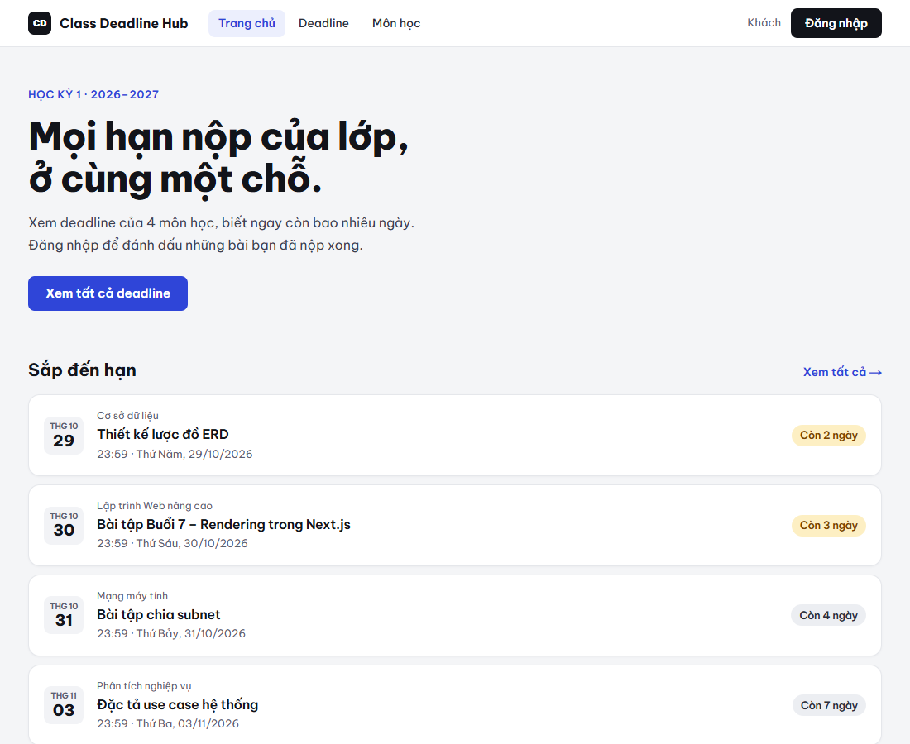 | 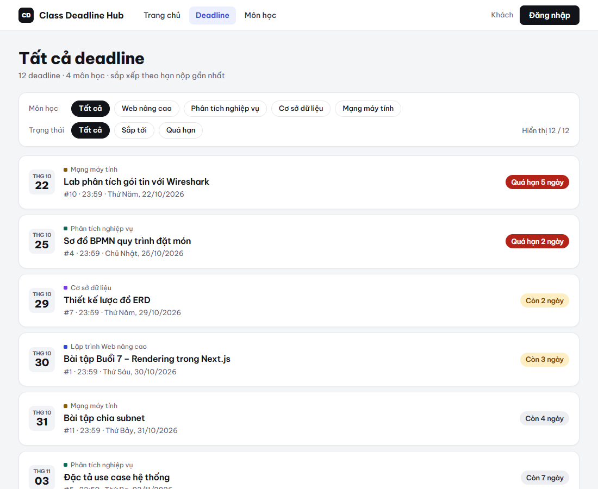 |
| **Chi tiết deadline (ISR on-demand)** | **Dashboard (SSR, layout lồng)** |
| 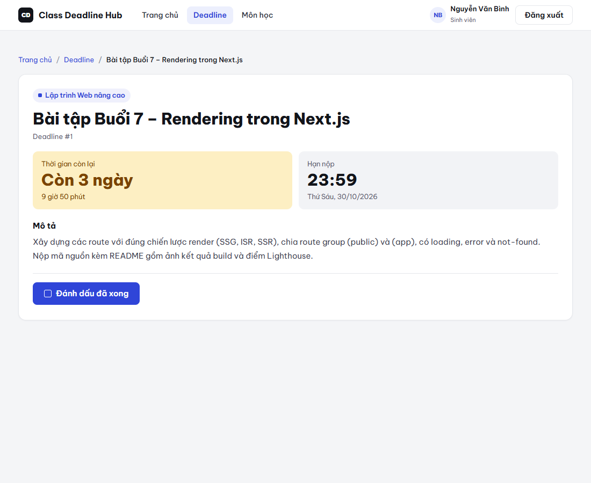 | 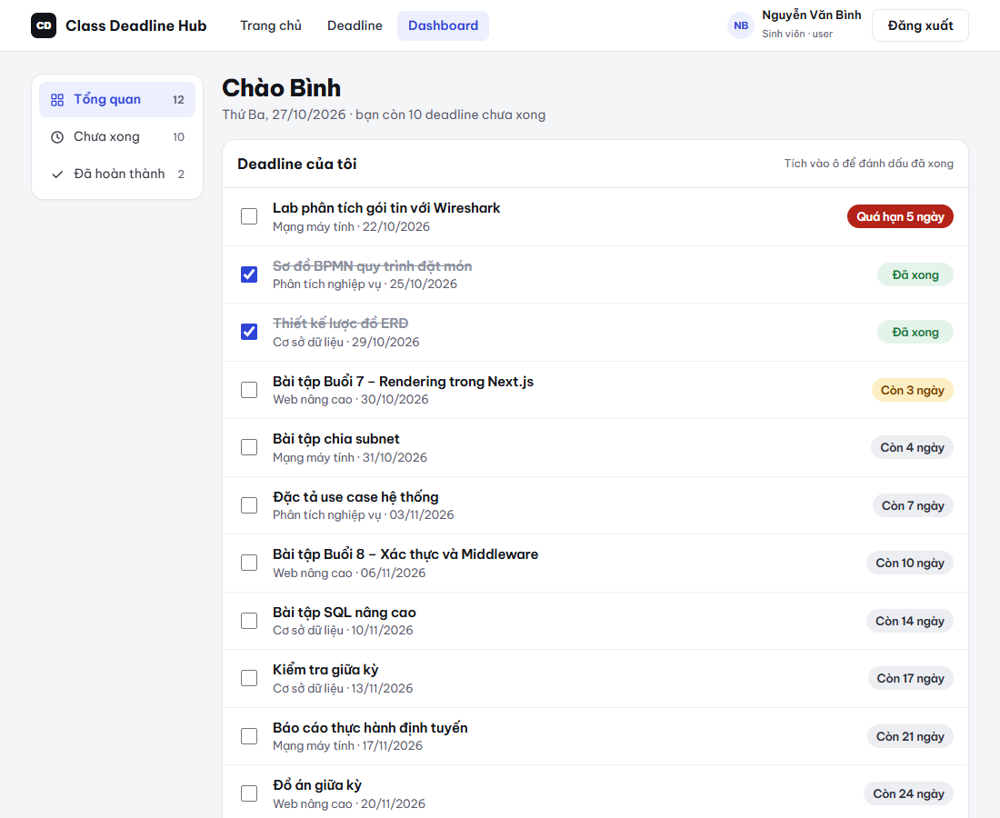 |
| **Quản trị — validate "Hạn nộp phải sau thời điểm hiện tại"** | **403 — user vào /admin** |
| 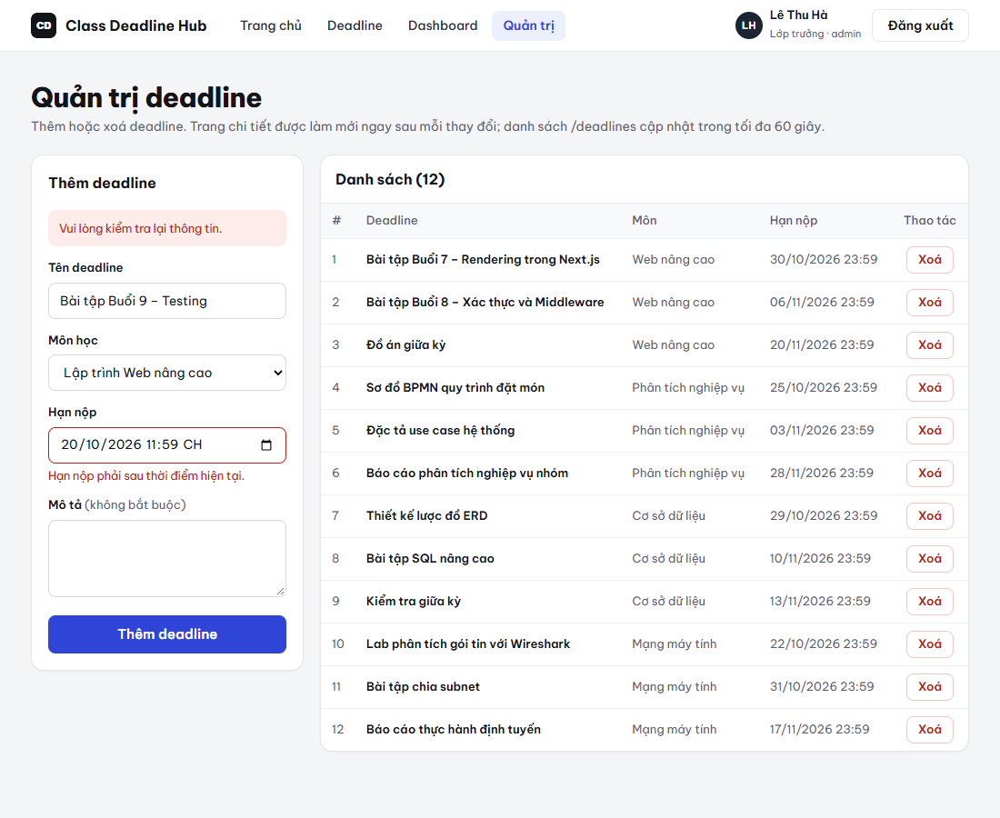 | 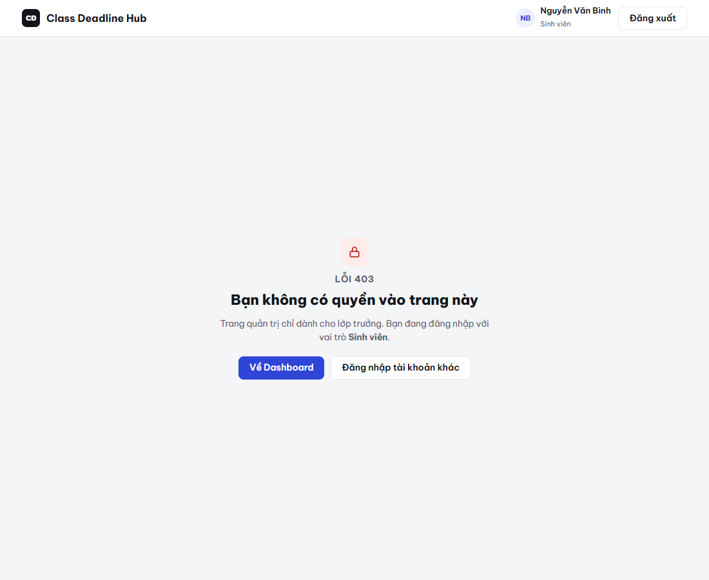 |
| **404 — /deadlines/99** | |
| 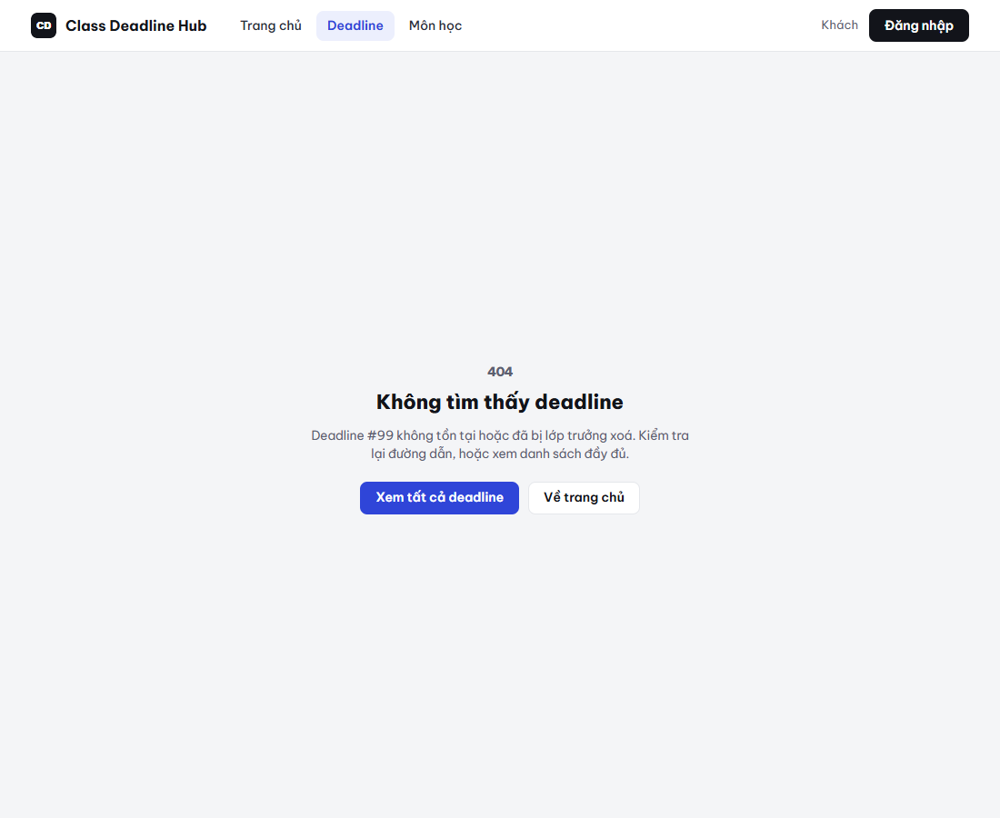 | |

- **loading.tsx**: `app/(public)/deadlines/(list)/loading.tsx` và `app/(app)/dashboard/loading.tsx` (skeleton).
- **error.tsx** có nút **Thử lại**. Để xem thử: `SIMULATE_ERROR=deadlines npm run dev` (PowerShell: `$env:SIMULATE_ERROR="deadlines"; npm run dev`) rồi mở `/deadlines`.
- `loading/error` của danh sách nằm trong route group `(list)` để **không bọc** `/deadlines/[id]`. Nếu bọc, Suspense sẽ stream HTML trước khi `notFound()` chạy và trang 404 bị trả về với status 200.

---

## 8. Điểm cộng

### Đăng nhập GitHub (OAuth)

1. GitHub → Settings → Developer settings → **OAuth Apps → New OAuth App**
   - Homepage URL: `http://localhost:3000`
   - Authorization callback URL: `http://localhost:3000/api/auth/callback/github`
2. Thêm vào `.env.local`: `AUTH_GITHUB_ID=...`, `AUTH_GITHUB_SECRET=...`, rồi khởi động lại.
3. Trang `/login` tự hiện nút **"Đăng nhập với GitHub"**. Tài khoản GitHub luôn có vai trò `user`; quyền admin chỉ cấp qua `data/users.json`. Ảnh đại diện GitHub hiển thị bằng `next/image`.

### Deploy lên Vercel

1. Đẩy mã nguồn lên GitHub, rồi trên Vercel chọn **Add New → Project → Import**.
2. Thêm Environment Variables: `AUTH_SECRET`, `NEXT_PUBLIC_SITE_URL=https://<tên>.vercel.app` (và `AUTH_GITHUB_*` nếu dùng; đổi callback URL của OAuth App sang domain Vercel).
3. Deploy. `next.config.ts` đã khai báo `outputFileTracingIncludes` để đóng gói `data/` và font của ảnh OG.

> Lưu ý: hệ thống file trên Vercel là chỉ đọc. `lib/db.ts` tự chuyển sang ghi vào `/tmp` khi chạy trên Vercel để demo vẫn thêm/xoá/đánh dấu được, nhưng dữ liệu **không bền vững** (mất khi instance khởi động lại, không chia sẻ giữa các instance). Muốn dùng thật nên thay `lib/db.ts` bằng một CSDL (Vercel Postgres, Turso, Upstash…). Phần còn lại không phải sửa vì mọi truy cập dữ liệu đều đi qua file này.
